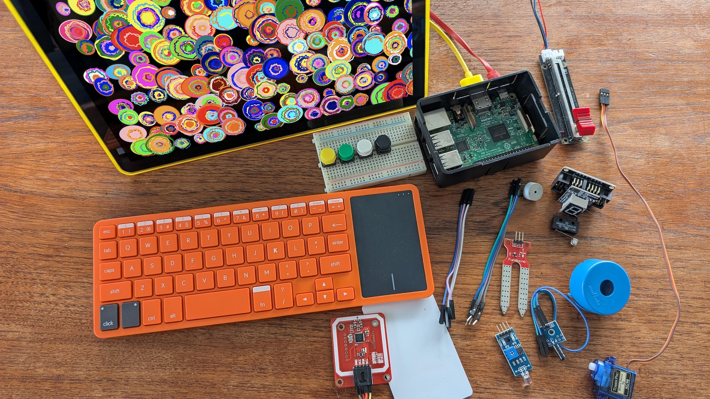

# Workshop: Responsive Installations

A p5.js sketch of one animated circle, plus a control panel of inputs.
Each input simulates a sensor until real hardware sends readings over a WebSocket.
Every input can be connected to any property of the circle or its animation.

## Files
| File | What it is | Who edits it |
|---|---|---|
| `steps/step1.js` … `steps/step12.js` | One p5.js sketch per workshop step (step 10: `PROPS`, the drawing, the animation) | Everyone — this is the canvas |
| `steps.js` | The list of steps and the step buttons | Add a step here |
| `controls.js` | The simulated sensors and the panel | Add inputs here |
| `hardware.js` | WebSocket connection to real hardware | Set hardware ranges in `HW_RANGES` |
| `wiring.js` | Breadboard diagrams: how to wire each part to the Pi | Change pins here |
| `codeview.js` | The **Code** button: shows and edits the step's sketch over the canvas | Rarely |
| `index.html`, `style.css` | Page and panel styling | Rarely |
| `pi_bridge.py` | The real Pi bridge: reads the wired parts with gpiozero, sends them to the sketch | List your wired parts in `WIRED` |
| `test_server.py` | Fake "Raspberry Pi" for testing without hardware | Rarely |
| `requirements.txt` | Python packages the servers need, on the Pi and on a laptop | Add packages here |
| `requirements-pi.txt` | Python packages only the Pi needs (Blinka, the ADS1115 library) | Add Pi-only packages here |
| `control.py` | Control panel on the Pi (port 8080): start, stop and watch each server from a browser | Rarely |
| `workshop` | `./workshop install` sets up the Pi (packages, I2C/SPI, control panel); also starts and stops the servers | Rarely |

**Locally:** open the folder with any static server (e.g. VS Code Live Server, or `python3 -m http.server`).
**p5.js Web Editor:** create a new sketch and upload the files. See the https note below before connecting hardware.

## Workshop steps
Each step of the tutorial is its own sketch in `steps/`, picked from the menu at the top of the panel,
stepped through with **‹ ›** or the **← →** keys, or chosen with `?step=3` at the end of the address (combine with `&ws=…` for an installation).
Each step adds one idea to the one before; **Code** shows the step's sketch.

**Editing the code:** in the Code view, change anything and press **Run** (or Ctrl/⌘+Enter). The step reloads with your edit.
Edits are saved in your browser, one per step, so they stay after a reload. The **Code ✎** button shows that a step is running an edit.
**Reset** goes back to the file. The files in `steps/` aren't changed. If the edit has an error, the panel shows it under the step description.
To keep an edit for good, copy it into `steps/stepN.js`.
On steps with input cards (9–11), the Code view has a second, read-only tab, **Sensors**. It shows how those cards work in short, simplified code
(`SENSOR_CODE` in `controls.js`), such as the push button giving 1 while it's held and 0 when it's let go.

1. **A circle** — the bare minimum: `createCanvas`, `background`, `circle`.
2. **Fill the window** — size the canvas to the space, position with `width`/`height`, `windowResized()`.
3. **Colour and variables** — RGBA colour (red, green, blue, alpha, 0–255); the circle's properties as named variables.
4. **Movement** — an animation clock with `deltaTime`; `sin()` makes the size breathe.
5. **Orbit and trails** — `cos()`/`sin()` orbit, colour cycling, a see-through background.
6. **The mouse as an input** — any input → 0..1 → `lerp()` to the range a property needs.
7. **The keyboard as an input** — a still circle; `keyPressed()` runs once per press: the space bar picks a random colour.
8. **Smoothing** — glide towards the target; an on/off input (mouse button) stops jumping.
9. **Simulated sensors** — a still circle and three panel cards (button → size, proximity → left/right, light → brightness); each `inputs.<id>.value` is 0..1, just like the mouse.
10. **Any input → any property** — every property in `PROPS`; the dropdowns choose the mapping.
    *Hidden for now (`hidden: true` in `steps.js`), so the menu shows Real hardware as step 10.*
11. **Real hardware** — step 9 plus `setupHardware()`: the same three parts doing the same things, now with readings from the Pi, and wiring diagrams.
12. **Outputs** — the sketch talks back: buttons send `sendToHardware()` messages, and the Pi beeps a piezo and lights 3 NeoPixels (see *Outputs* below).

To add a step, write `steps/stepN.js` and add a line to `STEPS` in `steps.js`. To hide one without deleting it, add `hidden: true` to its line.
A step gets input cards with `buildControlPanel(PROPS)` (or `buildControlPanel(null, ['slider', …])` for a few cards
without dropdowns) and real hardware with `setupHardware()`.

## The idea in one line
Hardware gives a number → we normalize it to **0..1** → we stretch it to a property's **min..max** → we smooth it.

## Connecting real hardware
1. Run a WebSocket server that sends sensor readings: `pi_bridge.py` on the Pi (already running if the control panel is set up: see *Starting and stopping the servers* below),
   or `python test_server.py` for fake readings without hardware (inside the venv: see *Installing the Python packages* below). Only wired some parts? Comment out the others in `WIRED` at the top of `pi_bridge.py`,
   so their cards keep simulating instead of reading noise from empty pins.
2. Type its address in the panel (e.g. `ws://raspberrypi.local:8765`) and press **Connect**.
3. Each input that receives a reading turns **LIVE** (green) and stops simulating. Inputs with no hardware keep simulating.
   If the connection drops, it retries every 2 s and the cards fall back to simulation.

For an installation, open the page with `?ws=ws://raspberrypi.local:8765` at the end of the address to connect automatically.

### Installing the Python packages
The packages go into a virtual environment (a `.venv` folder next to the files).
Recent Raspberry Pi OS (Bookworm and later) refuses `pip install` outside one ("externally-managed-environment").

**On the Pi, one command sets everything up**, in the `responsive-installations` folder, as your normal user (not with sudo):
```bash
./workshop install
```
It creates the `.venv`, installs `requirements.txt` and `requirements-pi.txt` (Blinka and the ADS1115 library), and the
NeoPixel library for that Pi's model. It also turns on I2C and SPI, turns the sound off on a Pi 3/4 (the NeoPixels need it), and
installs the control panel (see *Starting and stopping the servers*). It's safe to run again, e.g. after a `git pull`.
If it changed I2C, SPI or the sound, it ends by asking you to reboot once.

**On a laptop** (for `test_server.py`), once, in the `responsive-installations` folder:
```bash
python3 -m venv --system-site-packages .venv
source .venv/bin/activate
pip install -r requirements.txt
```

**Each time you open a new terminal:**
```bash
source .venv/bin/activate      # the prompt now starts with (.venv)
python pi_bridge.py            # on the Pi; or python test_server.py for fake readings
```

`--system-site-packages` lets the venv use the `gpiozero` that comes with Raspberry Pi OS, already set up for the Pi's pins
(and the libraries it needs for the pins and SPI). That's why `gpiozero` isn't in `requirements.txt`.
The same commands work on a laptop for `test_server.py`.

### Starting and stopping the servers
The Pi runs both servers for you, so you don't need a keyboard, a screen or a terminal on it:

- **WebSocket bridge** (`pi_bridge.py`, port 8765): sends the sensor readings to the sketch.
- **HTTP server** (port 8000): serves this page, at `http://raspberrypi.local:8000/?step=3`.

To start or stop them, open the **control panel** in your browser: `http://raspberrypi.local:8080` (or use the Pi's IP address).
Each server has **Start**, **Stop** and **Restart** buttons, and a window showing everything it prints, including errors.
**Clear** only empties the window; the server keeps running.

- A green **running** label means it's working.
- **Stopped** means someone pressed **Stop**.
- A red **crashed** label means it stopped on its own. Read the last lines of its window to see why.

Stop sends Ctrl+C, just like stopping it in a terminal, so `pi_bridge.py` releases the pins properly.
After editing `pi_bridge.py`, press **Restart** to load your changes.

While a browser is connected, the bridge's window shows the messages: `to browser:` with the readings that changed
(pressing the button prints `{"button": 1}`, letting go `{"button": 0}`) and `from browser:` for anything the sketch sends back.
The settings are at the top of `pi_bridge.py` (press **Restart** after changing them): `SHOW_EVERY_READING = True` prints
every reading, 30 a second; `SHOW_MESSAGES = False` prints none.

Want fake readings instead? **Stop** the bridge first, then run `python test_server.py` yourself.
Both use port 8765, and only one can use it at a time ("address already in use" means the other is still running).

**Setting up the control panel** is part of `./workshop install` (see *Installing the Python packages*):
```bash
cd responsive-installations
./workshop install
```
It starts both servers, and starts them again every time the Pi powers on.

**From a terminal or over SSH,** the same controls:
```bash
workshop status              # what's running, and the addresses to open
workshop stop bridge         # start / stop / restart; bridge, http or all
workshop logs bridge         # watch a server's output (Ctrl+C to exit)
```
The control panel has no password, so anyone on the same Wi-Fi can use it. Fine for a workshop room; think twice on a public network.

### Message format
JSON, as one object, several at once, or a list:
```
{"id": "slider", "value": 0.42}
{"slider": 0.42, "button": 1, "proximity": 37.5}
[{"id": "knob", "value": 0.1}, {"id": "pir", "value": 1}]
```
Plain text also works, one reading per line: `slider:0.42` or `button HIGH`.

Input ids: `button`, `switch`, `slider`, `knob`, `proximity`, `light`, `pir`, `touch`, `sound`, `joystickX`, `joystickY`.

Values are 0..1 by default. If your hardware sends another range, add it to `HW_RANGES` in `hardware.js`.
For example, proximity is set up for centimetres (200 cm = far, 2 cm = close), and a 10-bit ADC would be `{ min: 0, max: 1023 }`.
Digital inputs accept 0/1, HIGH/LOW, on/off or true/false.
To send something back to the Pi, call `sendToHardware({...})`. `pi_bridge.py` understands:
```
{"beep": {"hz": 880, "ms": 300}}                     the piezo plays a note (110–1760 Hz, up to 5 s)
{"pixels": [255, 120, 0]}                            every NeoPixel one colour; [0, 0, 0] = off
{"pixels": [[255, 0, 0], [0, 255, 0], [0, 0, 255]]}  one colour per pixel
```

### The https gotcha
Browsers won't let an **https** page (like the p5.js Web Editor) open a plain `ws://` connection to another computer.
`ws://localhost` is fine. To reach the Pi, serve the sketch over **http** (ideally from the Pi itself, then the default address points at it), or use `wss://`.
The panel tells you when this is what's blocking the connection.

Untick **listen** on a card to keep that input simulated even while the hardware is sending it.

## Wiring the parts to the Pi
Open **Wiring** at the bottom of any card for a breadboard diagram, the list of wires and the gotchas. Click a diagram to enlarge it.
The pins are planned so every part can be connected at the same time:

| Part | Connects to | Power |
|---|---|---|
| Push button | GPIO17 (pin 11) + GND, internal pull-up | none |
| Toggle switch | GPIO27 (pin 13) + GND, internal pull-up | none |
| Ultrasonic HC-SR04 | TRIG → GPIO23 (pin 16), ECHO → **1 kΩ/2 kΩ divider** → GPIO24 (pin 18) | 5 V |
| PIR HC-SR501 | OUT → GPIO22 (pin 15) | 5 V |
| Touch TTP223 | SIG → GPIO25 (pin 22) | 3.3 V |
| LDR (light sensor) | **ADS1115** breakout A0 (I2C: SDA → pin 3, SCL → pin 5); LDR from 3.3 V to A0, 10 kΩ from A0 to GND | 3.3 V |
| Slide pot · rotary pot · mic · joystick X/Y | MCP3008 CH0 · CH1 · CH3 · CH4/CH5 | 3.3 V |

The Pi has no analog inputs, so analog parts go through an ADC chip:
- The **LDR** uses an **ADS1115** breakout on I2C. `./workshop install` turns I2C on and installs its library
  (by hand: `sudo raspi-config` → Interface Options → I2C, and `pip install adafruit-blinka adafruit-circuitpython-ads1x15`).
  Then `i2cdetect -y 1` should show `48`.
  `pi_bridge.py` sends A0's voltage ÷ 3.3, so 0..1 (more light, higher).
- The other analog parts go through an **MCP3008** ADC on SPI
  (CLK → pin 23, DOUT → pin 21, DIN → pin 19, CS → pin 24). Turn SPI on with `sudo raspi-config` → Interface Options → SPI.
  `gpiozero.MCP3008(channel=n).value` already gives 0..1.

## Outputs
The Outputs step drives two parts on the Pi. They have no Wiring diagrams yet, so here are the connections:

| Part | Connects to | Power |
|---|---|---|
| Passive piezo | + → GPIO5 (pin 29), − → GND | none (the pin drives it) |
| 3 NeoPixels (WS2812B, chained) | DIN → GPIO18 (pin 12), through a 330 Ω resistor | 5 V (pin 2) + GND |

Three NeoPixels can run from the Pi's 5 V pin; for more, give them their own 5 V supply (with its GND joined to the Pi's).
The Pi's 3.3 V data signal usually works with a short chain; if the first pixel flickers or shows the wrong colour,
add a 74AHCT125 level shifter on the data line. List what you've wired in `OUTPUTS` at the top of `pi_bridge.py`.

The NeoPixels need their own library, and which one depends on the Pi. `./workshop install` picks the right one and installs it.
By hand, in the venv:

**Pi 5:**
```bash
pip install adafruit-blinka adafruit-blinka-raspberry-pi5-neopixel adafruit-circuitpython-pixelbuf
```

**Pi 3, 3+ or 4:**
```bash
pip install adafruit-blinka adafruit-circuitpython-neopixel
```
On these Pis the NeoPixel library needs root, and it shares hardware with the headphone jack's sound:
- Turn the sound off: `./workshop install` does it, or add `dtparam=audio=off` to `/boot/firmware/config.txt`. Then reboot.
- Run the bridge with sudo. The control panel does this for you on a Pi 3/4. By hand: `sudo .venv/bin/python pi_bridge.py`.

When the bridge starts, its window lists each output as `ready` or `skipped:` with the reason (a missing library, or no sudo).
A skipped output doesn't stop the rest: the sensors keep working.

## Seeing the code
Press **Code** (or **C**) to show the current step's sketch over the canvas; press it again to hide it.
Served over http it shows the file itself. Opened straight from disk, the browser won't let the page read the file,
so it shows the running settings and functions instead.

## Simulated inputs
Push button · toggle switch · slide pot · rotary pot · ultrasonic proximity (cm, with jitter and missed echoes) ·
LDR light sensor (with "cover" button) · PIR motion (stays HIGH 3 s) · capacitive touch · sound/mic (clap + noise floor) · joystick (X and Y).
Turn off **Realistic sensor noise** to compare clean vs. real-world readings.

## Things to try
- **Add a property:** add a line to `PROPS` in `steps/step10.js` and use `current.yourProp` in `draw()`. It appears in every dropdown.
- **Add an input:** add an entry to `INPUT_DEFS` and (if it's a new type) a widget in `WIDGETS` in `controls.js`. Hardware can then send readings under its id.
- **Change the feel:** `SMOOTHING` in any step from 8 on (1 = instant, 0.05 = dreamy).

## Component photos
Each card shows a small photo of the real part, loaded from Wikimedia Commons (openly licensed).
Tap a photo to open its Commons page with the author and licence. The file names are in `PHOTOS` in `controls.js`.
Photos need an internet connection and may be blocked in some embedded previews; if they can't load they simply hide.
For an offline venue, save them into an `images/` folder and change each `PHOTOS` entry to e.g. `'images/button.jpg'`.

Keys: **← →** previous / next step, **C** shows the code, **P** hides the panel (for projection), **F** toggles fullscreen.
